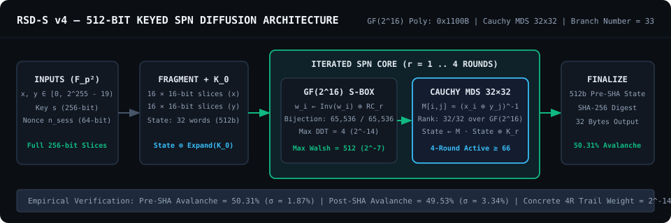
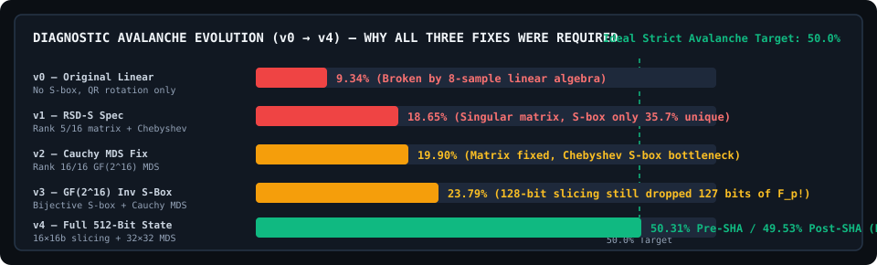

# BaSingSeCriptografy — RSD-S (`Riemann Spectral Diffusion` v4)

<p align="center">
  <b>Keyed 512-bit SPN cryptographic diffusion research laboratory over 𝔽<sub>p</sub>² (p = 2<sup>255</sup> − 19), featuring a GF(2<sup>16</sup>) inversion S-Box, 32×32 Cauchy MDS diffusion (Branch Number 33), Z3 SMT proofs, and synthesized DIMACS SAT/CNF circuits.</b>
</p>

<p align="center">
  <a href="https://github.com/daniloludgero/BaSingSeCriptografy/actions/workflows/ci.yml"></a>
  <a href="https://github.com/daniloludgero/BaSingSeCriptografy/releases/tag/v0.4.1"></a>
  <a href="https://github.com/daniloludgero/BaSingSeCriptografy/blob/main/LICENSE"></a>
  <a href="https://github.com/daniloludgero/BaSingSeCriptografy/blob/main/testes/test_rsd_s_v4.py"></a>
  <a href="https://daniloludgero.github.io/BaSingSeCriptografy/"></a>
</p>

<p align="center">
  
</p>

> [!CAUTION]
> **SCIENTIFIC HONESTY & RESEARCH PROTOTYPE DISCLAIMER**
> **RSD-S v4 is an experimental cryptographic research prototype and cryptanalysis workbench.**
> It has **NOT** undergone independent peer review or formal third-party security auditing, uses non-constant-time table lookups in Python, and **MUST NOT be used in production or to protect sensitive data**. Passing statistical avalanche tests and bounding single differential characteristics are necessary baseline criteria—not proofs of cryptographic security. See [`RELATORIO_FINAL.md`](RELATORIO_FINAL.md) and [`especificacao/RESTRICOES_DE_PROJETO.md`](especificacao/RESTRICOES_DE_PROJETO.md).

---

## Quickstart (Under 30 Seconds)

```bash
# 1. Clone and install NumPy
git clone https://github.com/daniloludgero/BaSingSeCriptografy.git
cd BaSingSeCriptografy
pip install -r requirements.txt

# 2. Verify all 4 Known-Answer Test (KAT) vectors & run the v1-vs-v4 diagnostic demo
python3 ferramentas/rsd_cli.py kat
python3 ferramentas/rsd_cli.py demo

# 3. Run the deterministic unit & cryptanalysis regression suite
python3 -m unittest discover -s testes -p "test_*.py" -v
```

Want to explore without installing anything? Open [`docs/index.html`](docs/index.html) locally or launch the **[Interactive Cryptanalysis Web Laboratory](https://daniloludgero.github.io/BaSingSeCriptografy/)**.

---

## Why This Repository Exists: The `v0 → v4` Diagnostic Postmortem

Most experimental cryptography repositories only publish their final code and claim perfection. **BaSingSeCriptografy** is built as an open-book cryptographic engineering laboratory: we preserve every broken iteration (`v1`, `v2`, `v3`) alongside the corrected `v4` primitive to demonstrate **why component-level correctness fails if system-level invariants are violated**.

<p align="center">
  
</p>

| Iteration | Implementation File | Structural Diagnosis | Measured Avalanche | Status |
| :--- | :--- | :--- | :---: | :---: |
| **v0** *(Original)* | [`especificacao_original.md`](especificacao/especificacao_original.md) | Purely linear (Chebyshev modulation + QR rotation, no S-box). Rotation matrix $R$ recovered completely with 8 linear observations. | `9.34% – 13.69%` | **Broken** *(Linear)* |
| **v1** *(RSD-S Spec)* | [`rsd_s_v1_original.py`](implementacao/rsd_s_v1_original.py) | Alleged "MDS" matrix $H_{i,j}=(i+1)(j+1)+(i\oplus j)$ has **rank 5 of 16** (singular). Chebyshev S-box has only **23,393 / 65,536** unique outputs (35.7%) due to `arccos` domain saturation. | `18.65%` | **Failed** *(Rank-5 & Non-Bijective)* |
| **v2** *(Matrix Fixed)* | [`rsd_s_v2_matriz_corrigida.py`](implementacao/rsd_s_v2_matriz_corrigida.py) | Replaced $H$ with a true Cauchy MDS matrix over $\mathbb{F}_{2^{16}}$ (rank 16/16, 0/300 singular minors). Marginal improvement proved the S-box was still a bottleneck. | `19.90%` | **Failed** *(S-Box Bottleneck)* |
| **v3** *(S-Box Fixed)* | [`rsd_s_v3_sbox_corrigida.py`](implementacao/rsd_s_v3_sbox_corrigida.py) | Replaced Chebyshev S-box with multiplicative inversion over $\mathbb{F}_{2^{16}}$ (`0x1100B`, 65,536/65,536 bijection, 49.27% isolated avalanche). Still failed globally! | `23.79%` | **Failed** *(Input Truncation)* |
| **v4** *(Full State)* | [`rsd_s_v4_final.py`](implementacao/rsd_s_v4_final.py) | **Root Cause Fixed**: `v1–v3` sliced 255-bit $\mathbb{F}_p$ inputs into only $8 \times 16 = 128$ bits, **silently discarding 127 bits (49.8%) of every input**. Expanded to $16 \times 16 = 256$ bits per input (32-word / 512-bit state) + $32 \times 32$ Cauchy MDS. | **50.31% Pre-SHA**<br>**49.53% Post-SHA** | **Passed Baseline Criteria** |

---

## Cryptanalysis & Formal Verification Highlights (`v4`)

All claims below are backed by executable scripts in [`implementacao/`](implementacao/), [`ferramentas/`](ferramentas/), and [`testes/`](testes/), with full empirical write-ups in [`resultados/`](resultados/):

| Verification Dimension | Mathematical / Empirical Result | Reproduction Command | Report |
| :--- | :--- | :--- | :--- |
| **GF(2¹⁶) S-Box Differential Uniformity** | Exact DDT uniformity $= 4$ ($\max_a \Pr[\Delta S = b \mid \Delta x = a] = 2^{-14}$). Algebraic reduction to degree-2 polynomial + 4 Z3 witnesses `(0, 1, 0x015E, 0x015F)`. | `python3 ferramentas/prova_ddt_smt.py` | [`analise_smt_2026-08-09.md`](resultados/analise_smt_2026-08-09.md) |
| **Cauchy MDS 32×32 Branch Number** | Branch number $\mathcal{B} = 33$ (maximum possible for a $32 \times 32$ matrix over $\mathbb{F}_{2^{16}}$). Full rank 32/32, 0 singular minors. | `python3 testes/teste_branch_number.py` | [`validacao_2026-07-28.md`](resultados/validacao_2026-07-28.md) |
| **Wide-Trail Active S-Box Bounds** | Minimum active S-boxes: **66** (4R), **99** (6R), **132** (8R), **165** (10R). Single-characteristic 4R bounds: $\le 2^{-924}$ (differential), $\le 2^{-462}$ (linear correlation). | `python3 ferramentas/rsd_cli.py bounds` | [`comparacao_rodadas_2026-08-09.md`](resultados/comparacao_rodadas_2026-08-09.md) |
| **MDS Boolean XOR Gate Synthesis** | $512 \times 512$ binary MDS matrix synthesized from **130,848** direct XOR gates down to **45,050** XOR gates (**65.57% reduction**), exported to DIMACS CNF. | `python3 implementacao/mds_xor_synthesis.py` | [`sintese_mds_2026-08-09.md`](resultados/sintese_mds_2026-08-09.md) |
| **Exact GF(2¹⁶) Inversion & Round-1 CNF** | Inversion encoded in **575 variables / 1,962 clauses**; fixed-key Round 1 exported in **64,986 variables / 246,056 clauses** (KAT verified SAT/UNSAT). | `python3 implementacao/rsd_round_cnf.py` | [`cnf_inversao_round1_2026-08-09.md`](resultados/cnf_inversao_round1_2026-08-09.md) |
| **Concrete 4-Round Differential Search** | Branch-and-bound + diversified background evaluation across 31,200 valid $\mathbb{F}_p^2$ pairs. Best concrete 4-round characteristic weight: **$2^{-1439}$** (`1, 32, 31, 32`). | `python3 implementacao/busca_diversificada.py` | [`busca_diversificada_2026-08-09.md`](resultados/busca_diversificada_2026-08-09.md) |

---

## Public API Contract (`implementacao/rsd_s_v4_final.py`)

```python
import sys
sys.path.insert(0, "implementacao")
from rsd_s_v4_final import diffuse_rsd_s_final, diffuse_rsd_s_final_PRE_SHA

# Inputs must strictly satisfy the v4 contract (no silent truncation):
# - x, y: integers in 0 <= value < 2**255 - 19 (F_p)
# - s:    exact 32-byte key (bytes)
# - n_sess: unsigned 64-bit integer in 0 <= n_sess < 2**64

key = bytes.fromhex("000102030405060708090a0b0c0d0e0f101112131415161718191a1b1c1d1e1f")
digest = diffuse_rsd_s_final(x=1, y=2, s=key, n_sess=1)
assert digest.hex() == "38659dbb20ab18e575e635a708bdd67131ab6afefc79b253c246ced16e8a41ac"
```

---

## Repository Architecture

```text
BaSingSeCriptografy/
├── README.md                        # High-converting overview, quickstart & postmortem summary
├── RELATORIO_FINAL.md               # Canonical Portuguese research report (v0 -> v4 + SMT/CNF)
├── CHANGELOG.md                     # Curated release history (Keep a Changelog)
├── LICENSE                          # MIT License
├── TRADEMARK_POLICY.md              # Brand & scientific honesty protection policy
├── SECURITY.md                      # Cryptanalysis & vulnerability disclosure protocol
├── CONTRIBUTING.md                  # DCO sign-off, Git workflow & honesty invariants
├── GOVERNANCE.md                    # BDFL -> TSC contributor ladder & RFC process
├── CITATION.cff                     # Academic citation metadata
├── pyproject.toml                   # Python package & tooling configuration
├── especificacao/
│   ├── especificacao_original.md    # Historical context of v0 and v1 proposals
│   └── RESTRICOES_DE_PROJETO.md     # Authorship, structural constraints & quantum threat boundaries
├── implementacao/
│   ├── rsd_s_v4_final.py            # Official v4 implementation (32 words, Cauchy MDS, GF(2^16) Inv)
│   ├── rsd_s_v3_sbox_corrigida.py   # Historical v3 (Inversion S-box + 128-bit truncation bug)
│   ├── rsd_s_v2_matriz_corrigida.py # Historical v2 (Cauchy MDS + Chebyshev S-box bug)
│   ├── rsd_s_v1_original.py         # Historical v1 (Rank 5/16 matrix + Chebyshev S-box)
│   ├── mds_real.py                  # Cauchy MDS construction & minor rank verifier over GF(2^16)
│   ├── mds_bitmatrix.py             # 512x512 boolean linear representation of the 32x32 MDS
│   ├── mds_xor_synthesis.py         # Greedy CSE XOR circuit synthesizer (130,848 -> 45,050 gates)
│   ├── gf16_inverse_cnf.py          # Exact DIMACS CNF encoder for GF(2^16) inversion
│   ├── rsd_round_cnf.py             # Full Round-1 DIMACS CNF exporter & KAT verifier
│   ├── rsd_differential_cnf.py      # Two-execution & compact Round-1 differential CNF generator
│   ├── analise_wide_trail.py        # Dynamic programming Wide-Trail active S-box bounds
│   ├── analise_trilhas_concretas.py # Single-active-word maximum-probability path tracer
│   ├── analise_duas_rodadas.py      # Concrete 2-round & 4-round DDT witness propagator
│   ├── busca_branch_bound.py        # Heuristic branch-and-bound 4-round trail searcher
│   └── busca_diversificada.py       # Diversified background & DDT-2/DDT-4 trail searcher
├── ferramentas/
│   ├── rsd_cli.py                   # Fast developer CLI (kat, demo, bounds, hash)
│   ├── prova_ddt_smt.py             # Algebraic + Z3 SMT proof of S-box DDT uniformity = 4
│   ├── busca_trilha_smt.py          # Z3 BitVec global multi-round trail model
│   └── *.cnf                        # Exported DIMACS CNF benchmark formulas
├── testes/
│   ├── test_rsd_s_v4.py             # Deterministic unittest suite (KAT, contracts, CNF, trails)
│   ├── test_cli_and_repo.py         # CLI, governance, SVG, and Web Lab integrity tests
│   ├── suite_testes_completa.py     # Statistical suite (MDS, bijection, avalanche, linearity, bits)
│   └── vetores_v4.json              # Canonical Known-Answer Test (KAT) vectors
├── resultados/                      # Reproducible empirical & formal verification reports
└── docs/
    ├── index.html                   # Interactive Cryptanalysis Web Laboratory (WCAG 2.1 AA)
    ├── lab/                         # Modular CSS & JS engine for live GF(2^16) & SPN inspection
    ├── assets/                      # Architecture & avalanche SVG diagrams
    ├── strategy/                    # Commercial Open-Source (COSS) sustainability model
    └── growth/                      # Show HN, Reddit & contributor acquisition playbooks
```

---

## Citation

If you reference **BaSingSeCriptografy (`RSD-S`)**, its diagnostic `v0 → v4` methodology, or its DIMACS CNF / SMT cryptanalysis models in academic or pedagogical work, please cite:

```bibtex
@software{ludgero2026basingse,
  author       = {Ludgero, Danilo},
  title        = {{BaSingSeCriptografy — RSD-S (Riemann Spectral Diffusion): Cryptographic Primitive Prototype & Formal Cryptanalysis Workbench}},
  year         = {2026},
  version      = {0.4.1},
  url          = {https://github.com/daniloludgero/BaSingSeCriptografy},
  license      = {MIT}
}
```
